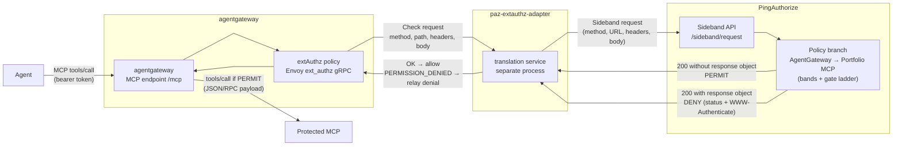

## Context

The [first article in this series](https://carbonefederico.github.io/blog-content/posts/centralizing-mcp-authorization-with-p1authorize-part-1-azure-apim/){:target="_blank"} implemented the PingAuthorize Sideband pattern on Azure API Management: APIM acted as the Policy Enforcement Point (PEP), a policy fragment forwarded every MCP call to the PingAuthorize Sideband API, and the business authorization logic lived entirely in the Policy Decision Point (PDP).

That pattern does not depend on Azure. This second part applies the same model to a different enforcement surface: **[agentgateway](https://github.com/agentgateway/agentgateway){:target="_blank"}**, an open source, Envoy-compatible proxy purpose-built for AI traffic — it natively serves MCP and A2A alongside plain HTTP and gRPC, and exposes an external authorization hook based on the Envoy ext_authz gRPC protocol.

The goal is the same as part 1: the gateway contains no business authorization logic. agentgateway captures the MCP call, hands its full context to PingAuthorize, and enforces whatever decision comes back. Same PDP, same Sideband API, same policy style — a different gateway.

The demo backend is also the same family as part 1: a demo financial MCP server exposing read tools and a risk-tiered write tool, with the same delegation gates, the same human-in-the-loop approval mirror, and the same default deny.

## What Problem This Article Solves: Enforcement Logic Per Platform

Part 1 described the general problem: authorization logic scattered across platforms produces duplication, drift, and audit gaps. This article solves the platform-specific version of it.

Every MCP-capable gateway has its own authorization extension point, and every extension point has a different contract. On APIM the contract is a policy fragment written in XML with C# expressions. On agentgateway the contract is [Envoy's external authorization filter](https://www.envoyproxy.io/docs/envoy/latest/configuration/http/http_filters/ext_authz_filter){:target="_blank"} — a gRPC `Authorization/Check` call whose semantics differ from the Sideband API in two critical ways:

- **Deny encoding** — Envoy ext_authz expects an explicit denial: a gRPC `PERMISSION_DENIED` status carrying a `DeniedHttpResponse`. PingAuthorize, in sideband mode, signals a denial with **HTTP 200 and an embedded `response` object** — which Envoy would happily read as *allow*. Pointing extAuthz directly at the Sideband API would silently pass every denial.
- **Envelope shape** — the Sideband API requires its own request format (headers as an array of single-entry objects, body as a string, bare `http_version`), not the Envoy `CheckRequest` structure.

So the problem is not *whether* agentgateway can delegate authorization — it can, natively — but *who translates* between the two contracts. The worst answer is embedding that translation in the MCP server or in bespoke gateway scripting: that re-creates exactly the per-platform logic this series is trying to eliminate.

The answer here is a small, standalone **translation adapter**: one component that speaks Envoy ext_authz on one side and the PingAuthorize Sideband API on the other, enforces fail-closed, and is reusable by any Envoy-compatible PEP.

## The solution

The implementation has three runtime components beyond PingAuthorize itself:

- **agentgateway** — the PEP. It terminates the MCP connection, attaches an `extAuthz` policy to the MCP endpoint, and forwards the call to the backend only on a permit.
- **paz-extauthz-adapter** — a small Node.js gRPC service that converts the Envoy `CheckRequest` into a Sideband envelope, calls PingAuthorize, and converts the decision back into an Envoy `CheckResponse`.
- **PingAuthorize** — the PDP, unchanged from part 1. The same server, now hosting a second policy branch and policy set alongside the APIM mortgage policies.



The adapter is a separate process, not a plugin inside the gateway binary. agentgateway's `extAuthz` policy simply points at it over gRPC. Because the adapter speaks the vendored Envoy ext_authz contract, it can serve other Envoy-compatible enforcement points later — the same decoupling idea as the APIM policy fragment, which was also a single reusable artifact.

> **Scope note:** As in part 1, this article focuses on the authorization integration. agentgateway's native JWT authentication (`mcpAuthentication`) is deliberately not configured: PingAuthorize validates the bearer token from the sideband envelope, exactly as it did for APIM. The demo MCP backend is open — in production it would validate a token minted for itself.

## The Sideband Integration Model

The three rules from part 1 are unchanged, because the PDP is unchanged:

1. **Permit** — the PDP returns HTTP 200 with no top-level `response` object.
2. **Deny** — the PDP returns HTTP 200 with a top-level `response` object containing a complete response for the PEP to relay verbatim: status code (`401` with `WWW-Authenticate`, or `403`), headers, and body.
3. **Fail closed** — transport failures and non-200 results are integration errors, not authorization decisions. The caller gets `502 Bad Gateway`, never implicit access.

What changes is where the rules are implemented. On APIM they lived inside a policy fragment; here they live in the adapter, which performs four translations:

| Envoy ext_authz | Adapter | PingAuthorize Sideband |
|---|---|---|
| `CheckRequest` (method, path, headers map, body, socket address) | builds envelope | `source_ip`, `source_port`, `method`, `url`, `http_version`, `headers[]`, `body` |
| gRPC status `OK` (0) | ← permit | HTTP 200, no `response` object |
| `DeniedHttpResponse` + gRPC `PERMISSION_DENIED` (7) | ← deny | HTTP 200 with `response` object |
| gRPC error → `failureMode: deny` | adapter unreachable | — |

One fidelity gain over part 1: APIM could not read the originating TCP source port, so the policy fragment used a synthetic `5034`. The adapter receives the real client socket address from Envoy's `CheckRequest` and forwards the actual `source_ip` and `source_port` — the PDP now evaluates the genuine network context instead of a placeholder.

For the same MCP call shape as part 1, the adapter sends to the sideband endpoint:

```json
{
  "source_ip": "203.0.113.10",
  "source_port": "50342",
  "method": "POST",
  "url": "http://localhost:3001/mcp/portfolio",
  "http_version": "1.1",
  "headers": [
    { "Accept": "application/json, text/event-stream" },
    { "Content-Type": "application/json" },
    { "Authorization": "Bearer <agent-access-token>" }
  ],
  "body": "{\"jsonrpc\":\"2.0\",\"id\":2,\"method\":\"tools/call\",\"params\":{\"name\":\"get_portfolio_summary\",\"arguments\":{\"customerId\":\"CUST-70001\"}}}"
}
```
{:.no-collapse}

A permit returns HTTP 200 with no `response` object and the adapter answers the gateway with gRPC `OK`. A denial returns HTTP 200 with one, and the adapter converts it into a `DeniedHttpResponse` carrying PingAuthorize's status, headers (including `WWW-Authenticate`), and body — which agentgateway relays to the client verbatim.

Two edge cases the adapter handles beyond the happy path:

- **Denial without a body** — PingAuthorize may deny with status and headers but no body. An MCP client receiving a bare HTTP error loses correlation with its pending JSON-RPC request, so the adapter synthesizes a JSON-RPC error envelope (`-32001` for 401, `-32003` for 403) echoing the original JSON-RPC `id`.
- **Adapter outage** — if the adapter process is down, the gRPC callout itself fails. agentgateway's `failureMode: deny` keeps the request closed. There is no permit-on-error path anywhere in the chain.

## The extAuthz Adapter

The adapter performs four operations, the same four the APIM fragment performed:

1. Extract the call context and rebuild the Sideband envelope.
2. Call the PingAuthorize Sideband API.
3. Translate the decision into an Envoy `CheckResponse`.
4. Fail closed on integration errors.

It is driven by five environment variables (the moral equivalent of APIM's Named Values):

| Variable | Type | Purpose |
|---|---|---|
| `SERVICE_URL` | Plain | Base URL of the Sideband API **without** `/sideband/request`, e.g. `https://paz.example.com:7443`. |
| `SECRET_HEADER_VALUE` | **Secret** | The sideband shared secret, sent in the `PDG-TOKEN` header. |
| `SIDEBAND_TIMEOUT_MS` | Plain | Per-attempt sideband timeout, `5000` by default. |
| `DEBUG_LOGGING` | Plain | `false` by default; `true` logs the redacted envelope and decision timing. |
| `LISTEN_PORT` | Plain | The adapter's gRPC listen port. |

### 1. Extract the Call Context and Rebuild the Sideband Envelope

Envoy delivers the request inside `CheckRequest.attributes`: the HTTP method, path, headers as a map, the raw body, and — unlike APIM — the real client socket address. The adapter maps these directly into the sideband fields, with the two encoding fixes the Sideband API requires: headers become an array of single-entry objects, and `http_version` drops the `HTTP/` prefix (the schema wants `1.1`, not `HTTP/1.1`).

```javascript
export function buildSidebandEnvelope(checkRequest) {
  const attrs = checkRequest?.attributes ?? {};
  const http = attrs.request?.http ?? {};
  const socket = attrs.source?.address?.socketAddress ?? {};

  const headers = [];
  for (const [name, value] of Object.entries(http.headers ?? {})) {
    headers.push({ [name]: String(value) });
  }

  const rawBody = http.rawBody != null
    ? Buffer.from(http.rawBody).toString("utf8")
    : undefined;
  const body = rawBody ?? (http.body != null && http.body !== "" ? http.body : null);
  const scheme = http.scheme ?? "http";
  const host = http.host ?? "localhost";
  const path = http.path ?? "/";

  return {
    source_ip: socket.address ?? null,
    source_port: socket.portValue != null ? String(socket.portValue) : null,
    method: http.method ?? "POST",
    url: `${scheme}://${host}${path}`,
    // Ping's sideband schema expects the bare protocol version, not "HTTP/1.1".
    http_version: (http.protocol ?? "HTTP/1.1").replace(/^HTTP\//, ""),
    headers,
    body,
  };
}
```

This is the same job the APIM fragment's envelope builder did inline, with one difference: `source_ip` and `source_port` come from Envoy's socket address instead of a synthetic `5034`.

### 2. Call the Sideband API

The adapter POSTs the envelope to `{SERVICE_URL}/sideband/request` with the shared secret in `PDG-TOKEN`, wrapped in the same retry logic as the APIM fragment: the decision probe is idempotent (a pure policy evaluation), and pooled keep-alive connections to the PDP can fail on a socket the server already closed. One immediate retry, then one after one second. A non-200 reply, or transport failure after all retries, returns a `502` (`sideband-error` and `sideband-unavailable` respectively).

```javascript
const retryDelaysMs = [0, 1000]; // one immediate retry, then one after 1s — the probe is idempotent

export async function callSideband(config, envelope, fetchImpl = globalThis.fetch) {
  const started = performance.now();
  let lastError = null;

  for (let attempt = 0; attempt < retryDelaysMs.length + 1; attempt += 1) {
    if (attempt > 0) {
      await new Promise((resolve) => setTimeout(resolve, retryDelaysMs[attempt - 1]));
    }
    try {
      const { response, body } = await fetchJsonWithTimeout(
        config, "/sideband/request", envelope, fetchImpl);
      const elapsedMs = Math.round(performance.now() - started);

      if (response.status === 200) {
        return body?.response
          ? { kind: "deny", body: body.response, elapsedMs }
          : { kind: "permit", body, elapsedMs };
      }
      return {
        kind: "error", status: 502, elapsedMs,
        message: `Sideband error (HTTP ${response.status})`,
      };
    } catch (error) {
      lastError = error;
    }
  }

  const detail = lastError?.name === "AbortError" ? "request timed out" : lastError?.message;
  return {
    kind: "error",
    status: 502,
    message: `Sideband unavailable${detail ? `: ${detail}` : ""}`,
    elapsedMs: Math.round(performance.now() - started),
  };
}
```

The helper `fetchJsonWithTimeout` performs the POST itself — the `PDG-TOKEN` header carries the shared secret, and an `AbortController` enforces the per-attempt timeout. The full source also detects stale-PAZ-certificate TLS failures to trigger a pod restart in the Kubernetes deployment; that operational detail is omitted here (the timing fields serve the adapter's debug logging).

### 3. Translate the Decision

The translation is the one asymmetric rule: HTTP 200 without a `response` object becomes gRPC `OK` (allow); HTTP 200 with a `response` object becomes gRPC `PERMISSION_DENIED` carrying a `DeniedHttpResponse` whose status, headers, and body are PingAuthorize's, relayed verbatim. This is the entire reason the adapter exists — without it, every denial would look like a permit.

```javascript
// Envoy wants camelCase through proto-loader; HttpStatus.code is the shared
// enum, numeric. gRPC status 7 = PERMISSION_DENIED (any nonzero denies).
function headerOptions(headerArray) {
  return (headerArray ?? []).map((entry) => {
    const [key, value] = Object.entries(entry ?? {})[0]
      ?? ["content-type", "application/json"];
    return { header: { key: String(key).toLowerCase(), value: String(value) } };
  });
}

export function toCheckResponse(result, originalBodyText) {
  if (result.kind === "permit") {
    return { status: { code: 0 } };
  }

  const isDeny = result.kind === "deny";
  const denyBody = isDeny ? result.body ?? {} : {};
  const statusCode = Number.parseInt(denyBody.response_code ?? result.status ?? 403, 10) || 403;
  const body = denyBody.body != null && denyBody.body !== ""
    ? denyBody.body
    : jsonRpcErrorBody(originalBodyText, statusCode,
        isDeny ? "Access denied" : (result.message ?? "Authorization failed"));

  return {
    status: { code: 7 },
    deniedResponse: {
      status: { code: statusCode },
      headers: headerOptions(denyBody.headers),
      body,
    },
  };
}
```

Two edge cases the adapter handles beyond the happy path:

- **Denial without a body** — PingAuthorize may deny with status and headers but no body. An MCP client receiving a bare HTTP error loses correlation with its pending JSON-RPC request, so the adapter synthesizes a JSON-RPC error envelope (`-32001` for 401, `-32003` for 403) echoing the original JSON-RPC `id`:

```javascript
function jsonRpcErrorBody(originalBodyText, statusCode, message) {
  const code = statusCode === 401 ? -32001
    : statusCode === 403 ? -32003
    : -32603;
  return JSON.stringify({
    jsonrpc: "2.0",
    id: rpcId(originalBodyText),
    error: { code, message },
  });
}
```

### 4. Fail Closed on Integration Errors

Any adapter-internal failure surfaces as a gRPC error, which agentgateway's `failureMode: deny` converts into a blocked request:

```javascript
// Any adapter failure must surface as a gRPC error so agentgateway's
// failureMode: deny keeps the request closed.
callback({ code: grpc.status.INTERNAL, message: error?.message ?? "adapter failure" });
```

The chain has no configuration in which an integration failure produces access.

## The Gateway Configuration

The gateway side needs no code — only configuration. The relevant part of `agentgateway.yaml`:

```yaml
routes:
- name: mcp-portfolio
  matches:
  - path:
      pathPrefix: /mcp/portfolio
  backends:
  - mcp:
      targets:
      - name: portfolio
        mcp:
          host: http://localhost:3000/mcp/portfolio
  policies:
    extAuthz:
      host: localhost:8083
      failureMode: deny
      protocol:
        grpc: {}
      includeRequestBody:
        maxRequestBytes: 65536
        allowPartialMessage: false
      policies:
        http:
          requestTimeout: 5s
```

Five settings matter:

- **The per-MCP route path** (`/mcp/portfolio`) — agentgateway serves one route per MCP, and the path is what PingAuthorize keys on: the sideband envelope carries the original client URL, and the policy tree selects the MCP by the leaf path segment. Adding a second MCP means a second route pointing at the same adapter, with the PDP tree gaining one leaf under the same wrapper — no gateway change beyond the route.
- **`includeRequestBody`** — without it, the `CheckRequest` would carry no body, and PingAuthorize would evaluate policy without seeing the tool name or the arguments. The body buffer is capped at 64 KiB, which bounds the memory cost of buffering.
- **`failureMode: deny`** — an unreachable adapter blocks the request instead of passing it.
- **`requestTimeout: 5s`** — the PDP callout budget, aligned with the adapter's own per-attempt sideband timeout.
- **Stateless mode** — per the [2026-07-28 MCP draft](https://modelcontextprotocol.io/specification/2026-07-28/basic/transports){:target="_blank"}, every POST is self-contained: no initialize/session handshake. This matches part 1's posture, where PingAuthorize permits a request and it goes straight to the backend; the HITL binding is token-to-payload via the transaction mirror, not session state.
- **No `mcpAuthentication`, no `backendAuth`** — token validation is delegated to PingAuthorize through the sideband endpoint's token validator, and the demo backend is open. Both omissions mirror part 1.

A second route serves the [RFC 9728](https://datatracker.ietf.org/doc/html/rfc9728){:target="_blank"} protected-resource metadata document by passthrough to the demo MCP backend. The backend derives the client-facing resource identifier from `X-Client-Host`/`X-Client-Proto` headers injected by the route — the same reason part 1 needed a separate plain API for metadata.

## Policies

To test the integration I used a demo portfolio MCP server — four tools: two reads (`get_portfolio_summary`, `list_positions`), a non-binding simulation (`simulate_trade`), and one risk-tiered write, `submit_trade_order`.

The policies live in a dedicated PingAuthorize version-control branch, deployed directly: PAZ's external PDP points at the branch by name, and the policy tree ships inside the branch snapshot. The sideband endpoint's `service` property selects the top-level policy set, and the set routes by the MCP leaf path segment carried in the envelope URL — the APIM path selects the mortgage set, the agentgateway MCP path selects the portfolio set. One PDP, two gateways, one audit trail.

The portfolio policy set evaluates six policies (FirstApplicable, after the global Token Validation policy rejects bad tokens with `401`):

1. **Session Methods** — protocol-level calls (`initialize`, `tools/list`, `ping`) are permitted for a valid token; with an invalid or missing token they are denied with `401`. These methods carry no tool, so no tool policy can apply to them.
2. **Read Tools** — the read tools are permitted for tokens carrying the `portfolio:read` scope.
3. **Order Tool: missing amount** — a `submit_trade_order` call with `amount ≤ 0` (or zero) is denied with `unpriceable_order_denied`: an order without a positive amount cannot be risk-assessed.
4. **Order Tool: medium risk HITL** — orders with `0 < amount ≤ Order Approval Threshold` require the full approval mirror: a token whose transaction context mirrors the payload field by field (`tool`, `customerId`, `symbol`, `side`, `quantity`, `amount`) and whose `txn` claim matches the transaction id in the payload. Without it, the order is denied with the machine-readable `approval_required` challenge — the denial *is* the challenge.
5. **Order Tool: high risk denied** — orders above the threshold are denied outright, approval or not. Large orders are not a policy problem for a human in the loop; they are simply refused.
6. **Default Deny** — unknown tools, wrong scopes, anything unmatched.

The band threshold is not hardcoded into the rules: it is an admin-tunable constant (`Constants.Order Approval Threshold`, 20,000 in the demo), so raising or lowering the limit is a policy edit, not a redeployment.

Every tool policy also carries a mandatory ladder of gates evaluated before its scope rule, with `DenyOverrides` combining so each gate gets a say:

- **R1 — audience**: the token must be minted for this MCP's resource identifier (`Constants.Portfolio_MCP Audience`, the RFC 8707 resource this gateway exposes). A token for the gateway root, however valid, is rejected with `401 invalid_token` — it was not issued for this resource.
- **R2 — declared agent**: when the call is delegated (the token carries `act.sub`), only the declared agent (`Constants.Portfolio Analysis Agent`) may act. A delegated token minted through any other agent identity is denied — agent authorization is an admin decision in the PDP, not a property of the token.
- **R3 — VIP user claim**: delegated access is reserved to VIP users; a standard user behind an agent is denied with `delegation_not_permitted`.

The risk model differs from part 1 — there the `changeType` argument classified the operation, here the monetary `amount` bands it — but the pattern is identical: risk is derived from the tool call payload, not the tool, so one write tool serves all bands and adding a tool never requires reconfiguring scopes.

The mirror rule in the HITL band catches a subtle failure: an approved token is bound to the exact payload it was approved for, field by field. Replaying an approved token against a drifted payload — an approved-for-10k token executing 50k, or any amount mismatch between token and order — breaks the mirror and the order is denied. And the band structure closes the gap a mirror alone cannot: even a perfectly mirrored 50,000 approval is denied, because the oversized band refuses the order regardless of who approved it or how the call is delegated.

## Testing the Chain

The project ships an end-to-end test script (`agentgateway/test/integration/policy-e2e-tests.sh`) that drives the full chain through the gateway endpoint: it mints scenario tokens on the fly with [JWT Lab](https://jwt-lab-beta.vercel.app){:target="_blank"} — a hosted RS256 test-token issuer with a REST API, described in [Issuing test tokens with JWT Lab](https://carbonefederico.github.io/blog-content/posts/jwt-lab-test-token-issuer/){:target="_blank"} — then runs a 27-scenario matrix and reports `27 passed, 0 failed` when everything holds.

The scenarios cover the policy set end to end:

- **Core policy matrix** — a read tool permitted with `portfolio:read` (and denied with only `portfolio:write`), a 3k order denied without approval (`403` + `approval_required`) and permitted with a mirrored approval, the band boundaries (an order at exactly 20k stays in the HITL band; 50k is denied outright even with a perfectly mirrored approval), an order without `amount` (or with zero) denied as unpriceable, approval replays denied (wrong `txn`, missing `txn`, drifted `amount`), an unknown tool denied by default, and an expired token rejected with `401`.
- **Transport posture** — a bodyless stream-open GET answered with the default deny (the chain responds, it never hangs or permits).
- **Delegation** — a VIP user acting through the declared agent permitted for reads and in-band orders, a standard user behind the agent denied even for reads (`delegation_not_permitted`), and delegation never extending a band: the oversized deny applies regardless of who is acting.
- **Ladder gates** — a delegated call from the declared agent permitted, the same call from an undeclared agent identity denied, and a token minted for the wrong audience (the gateway root instead of the MCP resource) rejected with `401 invalid_token`.

The script's own convention maps failures to layers: `401` = token validation, `403` = policy, `502` = sideband transport. Running it:

```bash
cd agentgateway/test/integration
./policy-e2e-tests.sh
```

**Verification on the PDP side** is the payoff of centralizing decisions. The PAZ decision audit shows every gateway's calls side by side — portfolio calls under the `AgentGateway` service, mortgage calls under the APIM service — one decision log for two enforcement platforms. The delegation gate itself follows the token-exchange patterns for preserving user context through an agent, described in [Securing agentic workflows with token exchange and workload identity](https://carbonefederico.github.io/blog-content/posts/spiffe-token-exchange-for-agent-workloads/){:target="_blank"}.

## When To Use This Pattern

The same conditions as part 1 apply, with one addition specific to this gateway:

- Multiple teams or platforms maintain separate authorization policies expressing the same business rules, making drift inevitable.
- Policy changes should not require redeploying gateways or editing code.
- Audit requirements need one centralized, queryable record of every authorization decision, regardless of the enforcing platform.
- Authorization rules depend on contextual attributes — roles, delegation claims, payload-derived risk — that evolve independently of applications.

And agentgateway specifically earns its place in the chain when the MCP surface itself is the thing being managed: aggregating multiple MCP targets behind one endpoint, protocol-level observability, or A2A alongside MCP. The extAuthz policy keeps those platform capabilities while the authorization decision stays external.

It is **not** the right tool when the MCP servers are already behind an existing APIM deployment — part 1's fragment is the lighter path there — or when a single team owns both gateway and servers and static scope checks genuinely suffice. Centralized policy is a cost paid for consistency at scale; it should be paid where the scale exists.

## Key Takeaways

This article moved the Sideband PEP pattern from APIM to agentgateway and showed the seam between two authorization contracts. agentgateway's extAuthz hook natively delegates authorization, but its Envoy semantics (gRPC `PERMISSION_DENIED` for denial) differ from PingAuthorize's sideband encoding (HTTP 200 with an embedded response object). A small standalone adapter — one process, five environment variables — bridges the two, enforces fail-closed, and is reusable by any Envoy-compatible enforcement point.

The result is structurally identical to part 1: a gateway with zero business authorization logic, one PDP evaluating both policy sets, real client network context reaching the PDP (a fidelity gain over the APIM fragment's synthetic source port), and the same approval-mirror pattern — hardened here with explicit order bands and a mandatory per-policy gate ladder — proven by a 27-scenario matrix.

The pattern now spans two very different platforms. The translation component differs — a policy fragment on APIM, an adapter process here — but the PDP, the policy style, the fail-closed posture, and the audit story are the same. That is the point of the series.

---

**Resources**

- [PingAuthorize Sideband API](https://docs.pingidentity.com/pingauthorize/11.1/pingauthorize_server_administration_guide/paz_about_sideband_api.html){:target="_blank"} — how the Sideband API proxies authorization decisions.
- [agentgateway documentation](https://agentgateway.dev/docs/){:target="_blank"} — standalone deployment, MCP configuration, and the external authorization policy reference.
- [Envoy External Authorization filter](https://www.envoyproxy.io/docs/envoy/latest/configuration/http/http_filters/ext_authz_filter){:target="_blank"} — the gRPC `Authorization/Check` contract the adapter implements.
- [Centralizing MCP Authorization with PingAuthorize - Part 1](https://carbonefederico.github.io/blog-content/posts/centralizing-mcp-authorization-with-p1authorize-part-1-azure-apim/){:target="_blank"} — the APIM integration this article mirrors.
- [Source code](https://github.com/carbonefederico/ai-mcp-gateways-paz-integrations) — the extAuthz adapter, gateway configuration, and the 27-scenario end-to-end suite (`agentgateway/test/integration/policy-e2e-tests.sh`).
