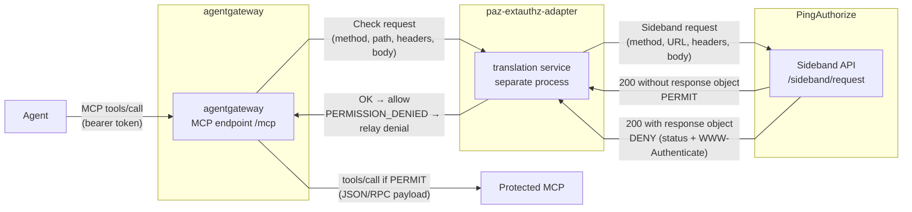

## Context

The [first article in this series](https://carbonefederico.github.io/blog-content/posts/centralizing-mcp-authorization-with-p1authorize-part-1-azure-apim/){:target="_blank"} implemented the PingAuthorize Sideband pattern on Azure API Management: APIM acted as the Policy Enforcement Point (PEP), a policy fragment forwarded every MCP call to the PingAuthorize Sideband API, and the business authorization logic lived entirely in the Policy Decision Point (PDP).

This second part applies the same model to **[agentgateway](https://github.com/agentgateway/agentgateway){:target="_blank"}**, an open source, Envoy-compatible proxy purpose-built for AI traffic. The goal is the same as part 1: the gateway contains no business authorization logic. agentgateway captures the MCP call, hands its full context to PingAuthorize, and enforces whatever decision comes back. Same PDP, same Sideband API, same policy style — a different gateway.

## What Problem This Article Solves: Enforcement Logic Per Platform

Agentgateway can delegate authorization decisions via an [Envoy's external authorization filter](https://www.envoyproxy.io/docs/envoy/latest/configuration/http/http_filters/ext_authz_filter){:target="_blank"} — a gRPC `Authorization/Check` call whose semantics differ from the PingAuthorize Sideband API. In this article I will describe a small standalone **translation adapter** that speaks Envoy ext_authz on one side and the PingAuthorize Sideband API on the other and allows us to integrate agentgateway with PingAuthorize.

## The solution

The implementation has three runtime components:

- **agentgateway** — the PEP. It terminates the MCP connection, attaches an `extAuthz` policy to the MCP endpoint, and forwards the call to the backend only on a permit.
- **paz-extauthz-adapter** — a small Node.js gRPC service that converts the Envoy authorization request into a Sideband envelope, calls PingAuthorize, and converts the decision back into an Envoy response.
- **PingAuthorize** — the PDP



The adapter is a separate process, not a plugin inside the gateway binary. agentgateway's `extAuthz` policy simply points at it over gRPC. Because the adapter speaks the vendored Envoy ext_authz contract, it can serve other Envoy-compatible enforcement points later — the same decoupling idea as the APIM policy fragment, which was also a single reusable artifact.

> **Scope note:** As in part 1, this article focuses on the authorization integration. agentgateway's native JWT authentication (`mcpAuthentication`) is deliberately not configured: PingAuthorize validates the bearer token from the sideband envelope, exactly as it did for APIM. The demo MCP backend is open — in production it would validate a token minted for itself.

## The Sideband Integration Model

The three rules from part 1 are unchanged, because the PDP is unchanged:

1. **Permit** — the PDP returns HTTP 200 with no top-level `response` object.
2. **Deny** — the PDP returns HTTP 200 with a top-level `response` object containing a complete response for the PEP to relay verbatim: status code (`401` with `WWW-Authenticate`, or `403`), headers, and body.
3. **Fail closed** — transport failures and non-200 results are integration errors, not authorization decisions. The caller gets `502 Bad Gateway`, never implicit access.

What changes is where the rules are implemented. On APIM they lived inside a policy fragment; here they live in the adapter, which performs the necessary translation.

Consider an agent reading a portfolio through the gateway:

```json
{
    "jsonrpc": "2.0",
    "id": 2,
    "method": "tools/call",
    "params": {
        "name": "get_portfolio_summary",
        "arguments": {
            "customerId": "CUST-70001"
        }
    }
}
```
{:.no-collapse}

The adapter sends this MCP call to the sideband endpoint as the following request:

```json
{
  "source_ip": "203.0.113.10",
  "source_port": "50342",
  "method": "POST",
  "url": "http://localhost:3001/mcp/portfolio",
  "http_version": "1.1",
  "headers": [
    { "Accept": "application/json, text/event-stream" },
    { "Content-Type": "application/json" },
    { "Authorization": "Bearer <agent-access-token>" }
  ],
  "body": "{\"jsonrpc\":\"2.0\",\"id\":2,\"method\":\"tools/call\",\"params\":{\"name\":\"get_portfolio_summary\",\"arguments\":{\"customerId\":\"CUST-70001\"}}}"
}
```
{:.no-collapse}

A permit returns HTTP 200 with no `response` object and the adapter answers the gateway with gRPC `OK`. A denial returns HTTP 200, and the adapter converts it into a `DeniedHttpResponse` carrying PingAuthorize's status, headers (including `WWW-Authenticate`), and body — which agentgateway relays to the client verbatim.

Two edge cases the adapter handles beyond the happy path:

- **Denial without a body** — PingAuthorize may deny with status and headers but no body. An MCP client receiving a bare HTTP error loses correlation with its pending JSON-RPC request, so the adapter synthesizes a JSON-RPC error envelope (`-32001` for 401, `-32003` for 403) echoing the original JSON-RPC `id`.
- **Adapter outage** — if the adapter process is down, the gRPC callout itself fails. agentgateway's `failureMode: deny` keeps the request closed. There is no permit-on-error path anywhere in the chain.

## The extAuthz Adapter

The adapter performs four operations:

1. Extract the call context and rebuild the Sideband envelope.
2. Call the PingAuthorize Sideband API.
3. Translate the decision into an Envoy `CheckResponse`.
4. Fail closed on integration errors.

### 1. Extract the Call Context and Rebuild the Sideband Envelope

Envoy delivers the request inside `CheckRequest.attributes`: the HTTP method, path, headers as a map, the raw body, and the real client socket address. The adapter maps these directly into the sideband fields, with the two encoding fixes the Sideband API requires: headers become an array of single-entry objects, and `http_version` drops the `HTTP/` prefix (the schema wants `1.1`, not `HTTP/1.1`).

```javascript
export function buildSidebandEnvelope(checkRequest) {
  const attrs = checkRequest?.attributes ?? {};
  const http = attrs.request?.http ?? {};
  const socket = attrs.source?.address?.socketAddress ?? {};

  const headers = [];
  for (const [name, value] of Object.entries(http.headers ?? {})) {
    headers.push({ [name]: String(value) });
  }

  const rawBody = http.rawBody != null
    ? Buffer.from(http.rawBody).toString("utf8")
    : undefined;
  const body = rawBody ?? (http.body != null && http.body !== "" ? http.body : null);
  const scheme = http.scheme ?? "http";
  const host = http.host ?? "localhost";
  const path = http.path ?? "/";

  return {
    source_ip: socket.address ?? null,
    source_port: socket.portValue != null ? String(socket.portValue) : null,
    method: http.method ?? "POST",
    url: `${scheme}://${host}${path}`,
    // Ping's sideband schema expects the bare protocol version, not "HTTP/1.1".
    http_version: (http.protocol ?? "HTTP/1.1").replace(/^HTTP\//, ""),
    headers,
    body,
  };
}
```

### 2. Call the Sideband API

The adapter POSTs the envelope to `{SERVICE_URL}/sideband/request` with the shared secret in `PDG-TOKEN`, wrapped in a retry logic.

```javascript
const retryDelaysMs = [0, 1000]; // one immediate retry, then one after 1s — the probe is idempotent

export async function callSideband(config, envelope, fetchImpl = globalThis.fetch) {
  const started = performance.now();
  let lastError = null;

  for (let attempt = 0; attempt < retryDelaysMs.length + 1; attempt += 1) {
    if (attempt > 0) {
      await new Promise((resolve) => setTimeout(resolve, retryDelaysMs[attempt - 1]));
    }
    try {
      const { response, body } = await fetchJsonWithTimeout(
        config, "/sideband/request", envelope, fetchImpl);
      const elapsedMs = Math.round(performance.now() - started);

      if (response.status === 200) {
        return body?.response
          ? { kind: "deny", body: body.response, elapsedMs }
          : { kind: "permit", body, elapsedMs };
      }
      return {
        kind: "error", status: 502, elapsedMs,
        message: `Sideband error (HTTP ${response.status})`,
      };
    } catch (error) {
      lastError = error;
    }
  }

  const detail = lastError?.name === "AbortError" ? "request timed out" : lastError?.message;
  return {
    kind: "error",
    status: 502,
    message: `Sideband unavailable${detail ? `: ${detail}` : ""}`,
    elapsedMs: Math.round(performance.now() - started),
  };
}
```

The helper `fetchJsonWithTimeout` performs the POST itself — the `PDG-TOKEN` header carries the shared secret, and an `AbortController` enforces the per-attempt timeout. The full source also detects stale-PAZ-certificate TLS failures to trigger a pod restart in the Kubernetes deployment; that operational detail is omitted here (the timing fields serve the adapter's debug logging).

### 3. Translate the Decision

The translation is the one asymmetric rule: HTTP 200 without a `response` object becomes gRPC `OK` (allow); HTTP 200 with a `response` object becomes gRPC `PERMISSION_DENIED` carrying a `DeniedHttpResponse` whose status, headers, and body are PingAuthorize's, relayed verbatim. This is the main reason the adapter exists — without it, every denial would look like a permit.

```javascript
// Envoy wants camelCase through proto-loader; HttpStatus.code is the shared
// enum, numeric. gRPC status 7 = PERMISSION_DENIED (any nonzero denies).
function headerOptions(headerArray) {
  return (headerArray ?? []).map((entry) => {
    const [key, value] = Object.entries(entry ?? {})[0]
      ?? ["content-type", "application/json"];
    return { header: { key: String(key).toLowerCase(), value: String(value) } };
  });
}

export function toCheckResponse(result, originalBodyText) {
  if (result.kind === "permit") {
    return { status: { code: 0 } };
  }

  const isDeny = result.kind === "deny";
  const denyBody = isDeny ? result.body ?? {} : {};
  const statusCode = Number.parseInt(denyBody.response_code ?? result.status ?? 403, 10) || 403;
  const body = denyBody.body != null && denyBody.body !== ""
    ? denyBody.body
    : jsonRpcErrorBody(originalBodyText, statusCode,
        isDeny ? "Access denied" : (result.message ?? "Authorization failed"));

  return {
    status: { code: 7 },
    deniedResponse: {
      status: { code: statusCode },
      headers: headerOptions(denyBody.headers),
      body,
    },
  };
}
```

Two edge cases the adapter handles beyond the happy path:

- **Denial without a body** — PingAuthorize may deny with status and headers but no body. An MCP client receiving a bare HTTP error loses correlation with its pending JSON-RPC request, so the adapter synthesizes a JSON-RPC error envelope (`-32001` for 401, `-32003` for 403) echoing the original JSON-RPC `id`:

```javascript
function jsonRpcErrorBody(originalBodyText, statusCode, message) {
  const code = statusCode === 401 ? -32001
    : statusCode === 403 ? -32003
    : -32603;
  return JSON.stringify({
    jsonrpc: "2.0",
    id: rpcId(originalBodyText),
    error: { code, message },
  });
}
```

### 4. Fail Closed on Integration Errors

Any adapter-internal failure surfaces as a gRPC error, which agentgateway's `failureMode: deny` converts into a blocked request:

```javascript
// Any adapter failure must surface as a gRPC error so agentgateway's
// failureMode: deny keeps the request closed.
callback({ code: grpc.status.INTERNAL, message: error?.message ?? "adapter failure" });
```

The chain has no configuration in which an integration failure produces access.

## The Gateway Configuration

The gateway side needs no code — only configuration. The relevant part of `agentgateway.yaml`:

```yaml
routes:
- name: mcp-portfolio
  matches:
  - path:
      pathPrefix: /mcp/portfolio
  backends:
  - mcp:
      targets:
      - name: portfolio
        mcp:
          host: http://localhost:3000/mcp/portfolio
  policies:
    extAuthz:
      host: localhost:8083
      failureMode: deny
      protocol:
        grpc: {}
      includeRequestBody:
        maxRequestBytes: 65536
        allowPartialMessage: false
      policies:
        http:
          requestTimeout: 5s
```

Five settings matter:

- **The per-MCP route path** (`/mcp/portfolio`) — agentgateway serves one route per MCP, and the path is what PingAuthorize keys on: the sideband envelope carries the original client URL, and the policy tree selects the MCP by the leaf path segment. Adding a second MCP means a second route pointing at the same adapter — no gateway change beyond the route.
- **`includeRequestBody`** — without it, the `CheckRequest` would carry no body, and PingAuthorize would evaluate policy without seeing the tool name or the arguments. The body buffer is capped at 64 KiB, which bounds the memory cost of buffering.
- **`failureMode: deny`** — an unreachable adapter blocks the request instead of passing it.
- **`requestTimeout: 5s`** — the PDP callout budget, aligned with the adapter's own per-attempt sideband timeout.
- **Stateless mode** — per the [2026-07-28 MCP draft](https://modelcontextprotocol.io/specification/2026-07-28/basic/transports){:target="_blank"}, every POST is self-contained: no initialize/session handshake where PingAuthorize permits a request and it goes straight to the backend; the HITL binding is token-to-payload via the transaction mirror, not session state.
- **No `mcpAuthentication`, no `backendAuth`** — token validation is delegated to PingAuthorize through the sideband endpoint's token validator, and the demo backend is open. 

A second route serves the [RFC 9728](https://datatracker.ietf.org/doc/html/rfc9728){:target="_blank"} protected-resource metadata document by passthrough to the demo MCP backend. The backend derives the client-facing resource identifier from `X-Client-Host`/`X-Client-Proto` headers injected by the route — the same reason part 1 needed a separate plain API for metadata.

## Policies

To test the integration I used a demo portfolio MCP server — four tools: two reads (`get_portfolio_summary`, `list_positions`), a non-binding simulation (`simulate_trade`), and one risk-tiered write, `submit_trade_order`. The live policy tree is five named policies under a per-MCP wrapper, plus the ever-present Default Deny — every request class is explicitly covered, with no implicit ordering fallbacks (FirstApplicable, after the global Token Validation policy rejects bad tokens with `401`):

| Policy | Condition | Verdict |
|---|---|---|
| **Session Methods** | MCP method calls (`initialize`, `tools/list`, `ping`) | gate ladder, then `portfolio:read` scope |
| **Read Tools** | the read tools (summary, positions, simulation) | gate ladder, then `portfolio:read` scope |
| **Order Tool: missing amount** | `submit_trade_order` AND `amount ≤ 0` (absent amounts resolve to 0 via the attribute's default value) | deny with `unpriceable_order_denied` |
| **Order Tool: medium risk HITL** | `submit_trade_order` AND `0 < amount ≤ threshold` | gate ladder, then `portfolio:write`, then the **approval mirror** |
| **Order Tool: high risk denied** | `submit_trade_order` AND `amount > threshold` | deny with `order_above_limit` — approval cannot exceed the band |
| **Default Deny** | everything else | deny |

The **gate ladder** is a set of mandatory rules inside Session Methods, Read Tools, and the HITL policy, combined with `DenyOverrides` so every rule evaluates — a permit hit under `FirstApplicable` would be terminal and silently skip the later gates:

- **Audience** — the token must be minted for the MCP-specific audience `Constants.Portfolio_MCP Audience` (the gateway's `/mcp/portfolio` resource URI, per RFC 8707). A token for the wrong resource is `invalid_token` → `401`.
- **Delegated-agent authorization** — fires only when the token delegates (`act.sub` present): the acting agent must equal the declared `Constants.Portfolio Analysis Agent` (`customer_support_agent`), an admin-declared allow-list. Any other delegated actor is denied with `agent_identity_mismatch`; non-delegated requests are outside this rule entirely. Authorization of an agent is an admin decision in the PDP, not a property of the token.
- **User claim** — delegated access is reserved to VIP users (`sub_type == vip_user`); a standard user behind an agent is denied with `delegation_not_permitted`.

In the HITL policy the mirror sits behind those gates and the `portfolio:write` scope check: the token's transaction context must mirror the payload field by field (`tool`, `customerId`, `symbol`, `side`, `quantity`, `amount`) and its `txn` claim must match the transaction id in the payload. Without it, the order is denied with the machine-readable `approval_required` challenge — the denial *is* the challenge.

The bands are tunable without touching a rule: `Constants.Order Approval Threshold` (a NUMBER constant, 20,000 in the demo) sets the HITL/deny boundary, and the audience and agent constants drive the ladder — raising or lowering the limit is a constant edit in the Policy Designer, not a redeployment.

## Key Takeaways

This article described how agentgateway can delegate authorization decisions to PingAuthorize. agentgateway's extAuthz hook natively delegates authorization, but its Envoy semantics (gRPC `PERMISSION_DENIED` for denial) differ from PingAuthorize's sideband encoding. A small standalone adapter bridges the two, enforces fail-closed, and is reusable by any Envoy-compatible enforcement point.

The pattern now spans two very different platforms, and this proves how PingAuthorize can centralize authorization decisions across different platforms. The translation component differs — a policy fragment on APIM, an adapter process here — but the PDP, the policy style, the fail-closed posture, and the audit story are the same.

---

**Resources**

- [PingAuthorize Sideband API](https://docs.pingidentity.com/pingauthorize/11.1/pingauthorize_server_administration_guide/paz_about_sideband_api.html){:target="_blank"} — how the Sideband API proxies authorization decisions.
- [agentgateway documentation](https://agentgateway.dev/docs/){:target="_blank"} — standalone deployment, MCP configuration, and the external authorization policy reference.
- [Envoy External Authorization filter](https://www.envoyproxy.io/docs/envoy/latest/configuration/http/http_filters/ext_authz_filter){:target="_blank"} — the gRPC `Authorization/Check` contract the adapter implements.
- [Centralizing MCP Authorization with PingAuthorize - Part 1](https://carbonefederico.github.io/blog-content/posts/centralizing-mcp-authorization-with-p1authorize-part-1-azure-apim/){:target="_blank"} — the APIM integration this article mirrors.
- [Source code](https://github.com/carbonefederico/ai-mcp-gateways-paz-integrations) — the extAuthz adapter, gateway configuration, and the 27-scenario end-to-end suite (`agentgateway/test/integration/policy-e2e-tests.sh`).
