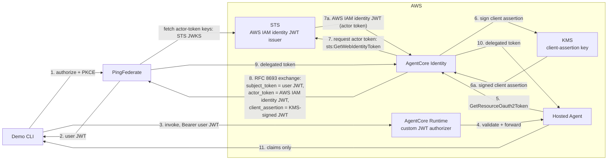
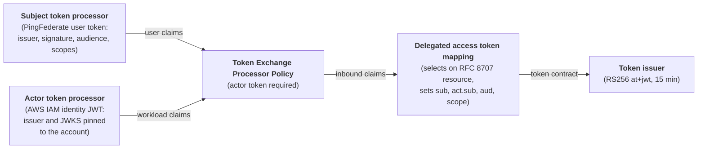

## Context

In a [previous article](https://carbonefederico.github.io/blog-content/posts/spiffe-token-exchange-for-agent-workloads/) I showed how to keep user context and workload accountability across applications, agents, and MCP servers using SPIFFE/SPIRE workload identities. At every service boundary, the calling workload fetched its own JWT-SVID from SPIRE and used it as the token exchange actor token. This article covers a similar approach for agents running in AWS Bedrock AgentCore, a managed runtime where SPIRE is not available.

The pattern is:

- use OAuth 2.0 Token Exchange to mint one delegated token from the user's token
- let the platform sign the client authentication with a KMS key the agent never sees
- let the platform obtain an AWS-signed identity JWT that proves which workload is asking
- let PingFederate validate all three inputs and issue one short-lived token carrying both identities for downstream services

## Why AgentCore Identity

[AgentCore Identity](https://docs.aws.amazon.com/bedrock-agentcore/latest/devguide/on-behalf-of-token-exchange.html) is the AWS service that handles outbound credentials for agents running on AgentCore. When an agent is invoked, the runtime gives it a workload access token through the SDK context. That token is short-lived, issued by the platform, and valid only inside AWS; the demo agent uses it to initiate on-behalf-of (OBO) token exchanges for downstream calls.

To complete the OBO token exchange, the agent invokes AgentCore Identity with its workload access token. AgentCore Identity:

- uses the user token from that invocation as the subject token
- obtains the AWS IAM identity JWT from STS, used as the actor token
- signs the `private_key_jwt` client assertion that authenticates against the PingFederate token endpoint
- sends the token exchange request
- returns the new token to the agent.

## Demo Architecture

The main components are:

- Demo CLI: signs the user in with PingFederate and invokes the agent.
- AgentCore Runtime: validates the inbound user JWT with a custom JWT authorizer before the invocation reaches the agent, and forwards the `Authorization` header.
- Hosted agent: a dummy agent that triggers the exchange and returns the resulting claims.
- AgentCore Identity: signs the client assertion, fetches the actor token from STS, and runs the RFC 8693 exchange against PingFederate.
- KMS: holds the RSA signing key for the client assertion.
- STS: issues the AWS IAM identity JWT used as the actor token.
- PingFederate: authenticates the user and issues the delegated token.



## Expected Flow

A normal demo run follows this path:

1. The CLI opens a browser and signs the user in at PingFederate with Authorization Code + PKCE.
2. PingFederate issues the user JWT with its audience pinned to the agent's invoke endpoint.
3. The CLI invokes the agent with the user JWT as a Bearer token.
4. AgentCore Runtime validates the user JWT against PingFederate's OIDC discovery document and the configured invoke audience, then forwards the `Authorization` header to the agent.
5. The agent takes the workload access token from the SDK context and calls `GetResourceOauth2Token` with the `ON_BEHALF_OF_TOKEN_EXCHANGE` flow.
6. AgentCore Identity signs a `private_key_jwt` client assertion with the agent's KMS key.
7. AgentCore Identity fetches the AWS IAM identity JWT of the agent from STS with `sts:GetWebIdentityToken`.
8. AgentCore Identity sends the RFC 8693 exchange to PingFederate: the user JWT as subject token, the AWS IAM identity JWT as actor token, and the KMS-signed assertion as client authentication.
9. PingFederate validates the subject token, the actor token, and the client assertion, then issues the delegated token.
10. The agent decodes the delegated token and returns its claims to the CLI.

The demo ends there, and that is deliberate. The agent is a harness, not a product: the point being demonstrated is the issuance of the delegated token, not its consumption. A real deployment would continue using the delegated token for downstream access.

## Workload Identity Model

In the SPIFFE demo, the OAuth client IDs were set equal to the workloads' SPIFFE IDs, which gave the authorization server a direct mapping between an OAuth client and an attested workload. AgentCore provides a similar trust model using AWS-native identities: instead of a SPIFFE ID, the authorization server identifies the workload through its AWS IAM execution role. The OAuth client's `client_id` is the agent's runtime execution role ARN, so the client in PingFederate is the AWS workload itself. Unique agent accountability requires one role per agent.

In AWS terms, this setup is outbound auth: configuring how the agent authenticates to external authorization servers. Triggering the token exchange requires an outbound auth configuration, which AgentCore stores as a credential provider and the agent references by name. The provider ties the pieces together:

```json
{
  "oauthDiscovery": {
    "discoveryUrl": "https://<pf-host>/.well-known/openid-configuration"
  },
  "clientId": "arn:aws:iam::<account>:role/AgentCore-runtime-role",
  "clientAuthenticationMethod": "PRIVATE_KEY_JWT",
  "privateKeyJwtConfig": {
    "privateKeySource": {
      "kmsKeySource": {
        "kmsKeyArn": "arn:aws:kms:<region>:<account>:key/<key-id>"
      }
    },
    "signingAlgorithm": "RS256",
    "additionalHeaderClaims": {
      "kid": "agentcore-pf-poc-1"
    }
  },
  "onBehalfOfTokenExchangeConfig": {
    "grantType": "TOKEN_EXCHANGE",
    "tokenExchangeGrantTypeConfig": {
      "actorTokenContent": "AWS_IAM_ID_TOKEN_JWT"
    }
  }
}
```

The `clientId` is the runtime execution role ARN, the same identity the actor token carries. `privateKeyJwtConfig` binds the client authentication to the KMS key: the key ARN as the private key source, `RS256` as the signing algorithm, and a `kid` header value that matches the `kid` in PingFederate's inline JWKS. `AWS_IAM_ID_TOKEN_JWT` tells AgentCore Identity to fetch the actor token from STS.

Trust on the PingFederate side is all public-key based: the agent's OAuth client holds an inline JWKS with the KMS key's public key, and the actor token is validated by a JWT processor pinned to the account's STS issuer and JWKS.

## The Agent Code

The hosted agent contains no OAuth logic and no secrets. The whole outbound flow is one call:

```python
from bedrock_agentcore.runtime.context import BedrockAgentCoreContext

@app.entrypoint
def invoke(payload, context):
    workload_access_token = BedrockAgentCoreContext.get_workload_access_token()

    agentcore = boto3.client("bedrock-agentcore", region_name=REGION)
    resp = agentcore.get_resource_oauth2_token(
        workloadIdentityToken=workload_access_token,
        resourceCredentialProviderName="pingfederate-obo-poc",
        oauth2Flow="ON_BEHALF_OF_TOKEN_EXCHANGE",
        scopes=["demo:read"],
        resources=["https://demo.example.internal/resource"],
    )
    exchanged_token = resp["accessToken"]
```

The agent passes the workload access token it received from the runtime, the name of the credential provider, the requested scopes, and the backend resource it intends to call. AgentCore Identity does everything else.

The `resources` parameter is the agent declaring which backend it needs a token for, and it travels through the exchange as the RFC 8707 `resource` parameter.

## The Exchange Request

AgentCore Identity assembles and sends the RFC 8693 request to the PingFederate token endpoint. The request contains all three inputs:

```http
POST /as/token.oauth2 HTTP/1.1
Host: <pf-engine>
Content-Type: application/x-www-form-urlencoded

grant_type=urn:ietf:params:oauth:grant-type:token-exchange
&subject_token=<user JWT>
&subject_token_type=urn:ietf:params:oauth:token-type:jwt
&actor_token=<AWS IAM identity JWT>
&actor_token_type=urn:ietf:params:oauth:token-type:jwt
&client_id=<runtime execution role ARN>
&client_assertion=<KMS-signed JWT>
&client_assertion_type=urn:ietf:params:oauth:client-assertion-type:jwt-bearer
&resource=https://demo.example.internal/resource
&scope=demo:read
```

## The Tokens

Four tokens participate directly in the OAuth exchange: three inputs and one output. AgentCore also uses an internal workload access token to authorize the `GetResourceOauth2Token` call.

**1. User token — the subject.** Issued by PingFederate after the browser login. Its audience is pinned to the agent's invoke endpoint, so a resource server that validates the audience rejects it for any other agent or API:

```json
{
  "iss": "https://<pf-engine>",
  "aud": "https://agentcore.demo.internal/agents/exchange_agent/invoke",
  "sub": "demouser",
  "client_id": "agentcore-demo-cli",
  "scope": "openid demo:read"
}
```

**2. Client assertion — the client authentication.** Signed by KMS with `private_key_jwt` semantics. The header carries `alg: RS256`, `typ: JWT`, and the `kid` that matches the PingFederate JWKS entry. Both `iss` and `sub` are the runtime execution role ARN, and the audience is the PingFederate token endpoint. PingFederate validates it against the client's inline public JWKS:

```json
{
  "iss": "arn:aws:iam::<account>:role/AgentCore-runtime-role",
  "sub": "arn:aws:iam::<account>:role/AgentCore-runtime-role",
  "aud": "https://<pf-engine>/as/token.oauth2",
  "jti": "<uuid>",
  "exp": "<iat + 90s>"
}
```

**3. Actor token — the workload proof.** The AWS IAM identity JWT from `sts:GetWebIdentityToken`, with an audience of the PingFederate token endpoint and a lifetime of up to five minutes. Its `sub` is the runtime role ARN, and AWS signs it. This is the token PingFederate maps into `act.sub`:

```json
{
  "iss": "https://<sts-issuer-id>.tokens.sts.global.api.aws",
  "aud": "https://<pf-engine>/as/token.oauth2",
  "sub": "arn:aws:iam::<account>:role/AgentCore-runtime-role",
  "https://sts.amazonaws.com/": {
    "aws_account": "<account>",
    "principal_id": "arn:aws:iam::<account>:role/AgentCore-runtime-role",
    "source_region": "eu-central-1"
  }
}
```

**4. Delegated token — the output.** Issued by PingFederate's token-exchange policy, combining all three inputs. This is what a downstream resource server would receive:

```json
{
  "iss": "https://<pf-engine>",
  "sub": "demouser",
  "act": {
    "sub": "arn:aws:iam::<account>:role/AgentCore-runtime-role"
  },
  "aud": "https://demo.example.internal/resource",
  "client_id": "arn:aws:iam::<account>:role/AgentCore-runtime-role",
  "scope": "demo:read",
  "exp": "<iat + 15 min>"
}
```

The `aud` chain runs through three parties. The agent requests the backend resource it needs and passes the target URI in `GetResourceOauth2Token`'s `resources` parameter. PingFederate decides whether to issue a token for it: AgentCore Identity carries the target into the exchange as the RFC 8707 `resource` parameter, and the delegated access token mapping stamps the delegated token's `aud` from it. The resource server enforces the audience when the token is used. The scope travels in `scope`, and the token lifetime is 15 minutes (configurable).

## PingFederate Configuration

PingFederate validates the incoming user token, validates the workload actor token, maps the relevant attributes, evaluates token-exchange policy, and issues the next access token. As in the previous article, the subject token and actor token come from different issuers: the subject is a PingFederate access token, and the actor is an AWS IAM identity JWT. PingFederate validates each token independently and combines the results in the exchange policy.



The key PingFederate configuration elements are:

- a token-exchange processor policy with the actor token required, so an exchange without workload proof fails
- a subject token processor for PingFederate-issued user tokens
- an actor token processor for AWS IAM identity JWTs with the issuer and JWKS pinned to AWS
- a contract mapping `sub` from the subject token's `sub` and `act.sub` from the actor token's `sub`
- a delegated access token mapping that selects on the requested resource URI and stamps the delegated token's audience and scopes; a resource URI that no mapping claims is rejected with `invalid_target`

The demo config leaves two authorization decisions implicit. Validating that the subject token is genuine and the actor is a legitimate AWS workload establishes who the parties are; it does not authorize the delegation between them. And nothing verifies that the authenticated client matches the actor: the `client_id` and the actor token's `sub` both name the runtime role, but PingFederate does not compare them. The IAM and provider configuration restrict access to the exchange — the provider's `clientId` is fixed in its configuration, and only the role holding the `GetResourceOauth2Token` grant can drive it — but they do not enforce delegation authorization.

A production deployment should turn both into explicit policy. PingFederate evaluates issuance criteria on the delegated access token mapping, and each criterion is an [OGNL expression](https://docs.pingidentity.com/pingfederate/13.1/administrators_reference_guide/pf_construct_ognl_express.html): one comparing `client_id` against the actor token's `sub` rejects any client-actor mismatch, and one checking the subject against the actor's delegation policy restricts which workloads may act for which users. Both run per request, before any token is issued.

The agent client itself is registered with no secret: `private_key_jwt` client authentication against the inline JWKS holding the KMS public key.

## When To Use This Pattern

This pattern fits when your agents run on AgentCore and call resources governed by your own authorization server, and you want the agents to hold no secrets and no OAuth code. The platform performs the workload identity assertion, the signing, and the exchange, and your authorization server makes the delegation decision.

As before, token exchange does not replace API authorization. The resource server still validates the token and enforces scopes and object-level rules. Token exchange gives it a better token to validate.

## Key Takeaways

The point of the demo is not that an agent can call a service. The point is that the agent proves itself with an identity minted by the platform it runs on, and the user's token stops at the exchange: downstream services receive only the delegated token minted for them.

That is the same core pattern as the SPIFFE article with a different trust root. Delegation travels through OAuth token exchange, workload identity is vouched for by the platform, and each service validates only the token meant for it.

## Links

- Previous article: [Securing agentic workflows with token exchange and workload identity](https://carbonefederico.github.io/blog-content/posts/spiffe-token-exchange-for-agent-workloads/)
- Source code: [carbonefederico/ai-agentcore-token-exchange](https://github.com/carbonefederico/ai-agentcore-token-exchange)
- OAuth 2.0 Token Exchange: [RFC 8693](https://datatracker.ietf.org/doc/html/rfc8693)
- AgentCore Identity on-behalf-of token exchange: [AWS documentation](https://docs.aws.amazon.com/bedrock-agentcore/latest/devguide/on-behalf-of-token-exchange.html)
- AgentCore client authentication methods: [AWS documentation](https://docs.aws.amazon.com/bedrock-agentcore/latest/devguide/client-auth-methods.html)
- AgentCore inbound JWT authorizer: [AWS documentation](https://docs.aws.amazon.com/bedrock-agentcore/latest/devguide/inbound-jwt-authorizer.html)
- PingFederate OAuth configuration: [PingFederate documentation](https://docs.pingidentity.com/pingfederate/latest/administrators_reference_guide/pf_oauth_config.html)
